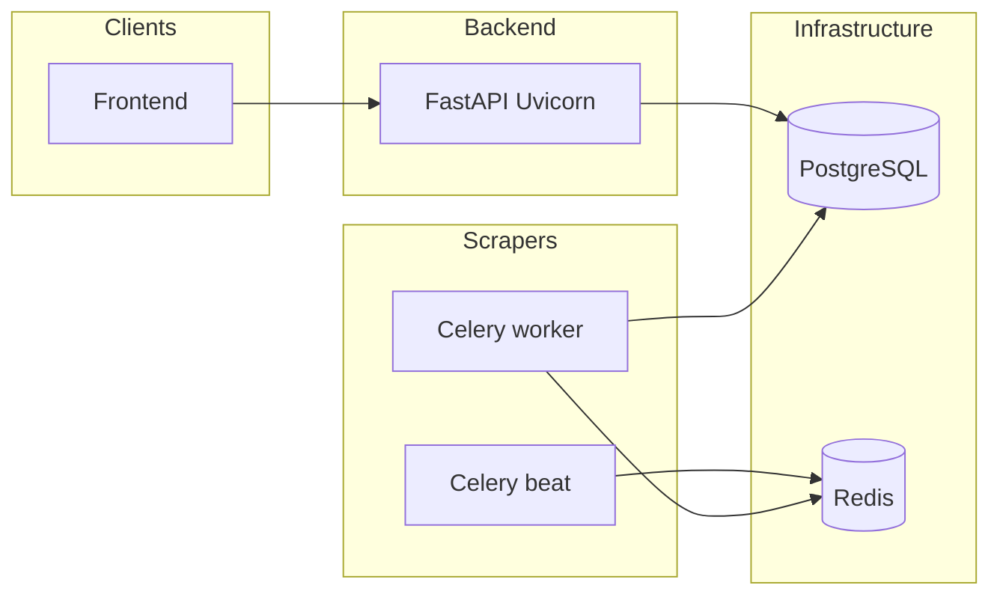

# AQ — Data Intelligence Hub

A modular, scalable data intelligence platform that collects, stores, and serves time-series data across multiple domains.


//running backend 
uvicorn app.main:app --reload

## Quick Start

```bash
make setup   # Copy env files
make up      # Start all services (Docker)
make migrate # Run database migrations (required after clone / new migrations)
```

- **Frontend**: http://localhost:3000  
- **Backend API**: http://localhost:8000  
- **API Docs**: http://localhost:8000/docs  

### Run the backend locally (without Docker)

```bash
cd backend
python -m venv .venv && source .venv/bin/activate
pip install -r requirements.txt
cp .env.example .env   # set DATABASE_URL, REDIS_URL, etc.
alembic upgrade head
uvicorn app.main:app --reload
```

---

## How the backend, scraper, and Celery fit together

The **backend** (FastAPI) is only an HTTP API. It **does not** run the EWURA scraper inside Uvicorn.

The **scrapers** package is a separate Python project under `scrapers/`. It fetches EWURA pages, downloads PDFs/DOCX in memory, parses tables, and **writes two kinds of rows in PostgreSQL**:

1. **`document_ingestion_fingerprints`** — dedupe metadata (URL + content hash + parse status).  
2. **`ewura_fuel_observations`** — actual cap-price rows (town, fuel type, price, etc.) that the **backend reads** and exposes at:

   `GET /api/v1/energy/fuel/ewura`

**Celery** is a background job runner. The scraper’s EWURA task is registered as **`scrapers.run_ewura_fuel`**. Celery **does not** live inside the FastAPI process: it runs in a **separate worker process** (or container) that imports the same `scrapers` code and uses:

- **Redis** as the **message broker** (and optional result backend) — only for Celery queues, not for your domain data.  
- **PostgreSQL** as the **system of record** — shared with the backend so both API and workers see the same data.



There is **no direct HTTP call** from the scraper worker to the backend for ingestion: both talk to **Postgres**. That matches `rules.md` (scrapers must not import the FastAPI `app` package).

---

## Running the EWURA scraper

### Option A — Automatically (recommended for production)

Use **Celery Beat** to enqueue **`scrapers.run_ewura_fuel`** on a schedule, and a **Celery worker** to execute it.

With **Docker Compose** (this repo):

- **`celery_worker`** — runs the worker.  
- **`celery_beat`** — publishes scheduled tasks.  
- **`db`** / **`redis`** — must be up; the worker needs the same **`DATABASE_URL`** (and broker URL) as in `.env`.

The default Beat schedule (in `scrapers/src/workers/celery_app.py`) runs EWURA **monthly** (1st of the month, 07:00 UTC). Change the `crontab` there if you need a different cadence.

### Option B — Manually (one-off, no Celery)

From the `scrapers` directory, with `DATABASE_URL` set so rows can be written:

```bash
cd scrapers
python -m venv .venv && source .venv/bin/activate
pip install -r requirements.txt
cp ../backend/.env .env   # or symlink; needs DATABASE_URL, optional REDIS_URL for Celery only
python -c "
from src.domains.energy.fuel_scraper import EwuraFuelScraper
s = EwuraFuelScraper()
try:
    s.run()
finally:
    s.close()
"
```

`EwuraFuelScraper.run()` lists documents, parses PDF/DOCX, updates fingerprints, and **persists** successful parses to **`ewura_fuel_observations`**.

### Option C — Trigger a single Celery task from the CLI

Worker must already be running and connected to Redis:

```bash
cd scrapers
source .venv/bin/activate
celery -A src.workers.celery_app call scrapers.run_ewura_fuel
```

---

## Celery commands (reference)

Run these from the **`scrapers`** directory (or set `PYTHONPATH` / working directory accordingly).

| Purpose | Command |
|--------|---------|
| **Worker** (consumes tasks) | `celery -A src.workers.celery_app worker --loglevel=info` |
| **Beat** (scheduler) | `celery -A src.workers.celery_app beat --loglevel=info` |
| **Worker + Beat in one shell (dev only)** | `celery -A src.workers.celery_app worker --beat --loglevel=info` |
| **Fire EWURA task once** | `celery -A src.workers.celery_app call scrapers.run_ewura_fuel` |

Docker Compose equivalents are already set for **`celery_worker`** and **`celery_beat`** (see `docker-compose.yml`).

**Note:** Celery runs in the **scraper** project, **not** inside the `backend` Uvicorn process. The backend image does not need to run Celery unless you deliberately combine roles on a small VPS.

---

## Hosting: backend + scraper together?

Typical production layout:

1. **PostgreSQL** (managed or container).  
2. **Redis** (managed or container) for Celery.  
3. **Backend** — always-on service running `uvicorn` (or gunicorn+uvicorn workers).  
4. **Celery worker** — always-on process(es) running the scraper code.  
5. **Celery Beat** — single scheduler process.  
6. **Frontend** — static/SSR host (e.g. Vercel, or same VPS).

You **can** deploy all workers on the **same VPS** as the API (e.g. one `docker-compose up`). You **should not** rely on a **pure serverless** API (short-lived functions only) to **host Celery**: workers must stay running. If you use a “cheap” serverless API (e.g. some FaaS offerings), run **Celery on a small always-on VM/container** (Fly.io, Railway worker, Render background worker, EC2, etc.) with the same `DATABASE_URL` and `REDIS_URL`.

---

## Project structure

```
aq/
├── backend/          # FastAPI application (domain-driven modules)
├── frontend/         # Next.js dashboard (App Router + TypeScript)
├── scrapers/         # Independent data collection workers + Celery app
├── shared/           # Constants and types shared across services
├── infra/            # Docker, Nginx, automation scripts
├── docs/             # Architecture and domain documentation
├── .github/          # CI/CD workflows
├── .husky/           # Git hooks (lint, commit message validation)
├── rules.md          # Mandatory project rules and conventions
└── docker-compose.yml
```

See [docs/setup.md](docs/setup.md) for detailed development setup.

See [rules.md](rules.md) for project conventions and coding standards.

## License

Private — All rights reserved.
